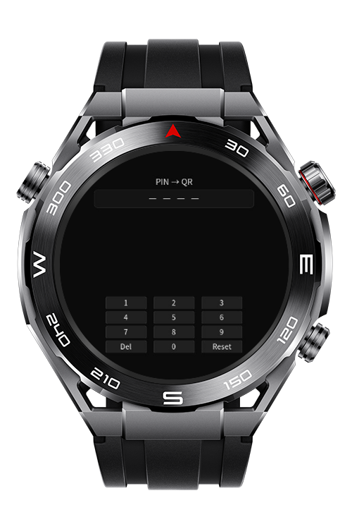
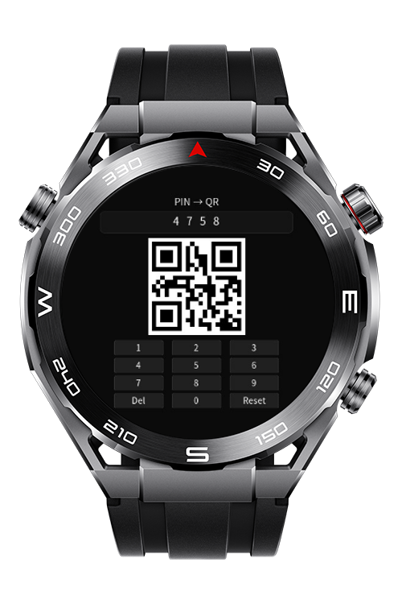

> **Note:** To access all shared projects, get information about environment setup, and view other guides, please visit [Explore-In-HMOS-Wearable Index](https://github.com/Explore-In-HMOS-Wearable/hmos-index).

# Sportwatch How To Pin QR

A lightweight PIN-to-QR generator app made for HarmonyOS wearables.

You type a 4-digit PIN → the app instantly renders a scannable QR code.  
Designed for ultra-fast short codes (pairing tokens / door pins / POS quick-auth).

# Preview

<p align="center">
  
  
</p>

# Use Cases
- Quickly convert short 4-digit PINs into QR codes for pairing or quick authentication.
- Standalone functionality without dependency on external devices.
- Optimized for minimal interaction and fast workflow on touch-based HarmonyOS screens.

# Technology

## Stack (Languages, Frameworks, Tools, Libraries, 3rd Party)
- **Languages**: HML, CSS, JavaScript
- **Frameworks/Tools**: HarmonyOS Lite Wearable (JS), DevEco Studio
- **3rd Party**: Built-in `<qrcode>` component for QR rendering

## Required Permissions
No runtime permissions are required for basic QR generation. For added features like haptics or sounds, declare corresponding capabilities.

## Diagrams - Process
```sequence
User->PinQR App: Input PIN (0-9)
PinQR App->QR Component: Generate QR if PIN = 4 digits
User->App: View and scan QR
```

# Tech Stack
- HML (Hypertext Markup Language)
- CSS (Cascading Style Sheets)
- JavaScript (Logic and QR binding)
- HarmonyOS APIs for wearable devices

# Directory Structure

```text
entry/src/main/pages/
  ├── Index.hml        # User interface for PIN input and display
  ├── Index.css        # Styling for app components
  └── Index.js         # Logic for keypad functionality and QR generation
```

# Constraints and Restrictions

## Supported Devices
- Huawei Watch 5
- DevEco Studio Simulator (for testing and debugging)

# Technical Constraints
- Platform Scope
  - Specifically built for HarmonyOS Lite Wearable JS pages; not compatible with ArkTS. Features beyond Lite JS are excluded from this scope.

- Input Validation
  - Only accepts 4-digit PINs to generate QR codes. Longer or invalid inputs are not supported.

- Security and Privacy
  - PIN entry is masked, but the generated QR encodes the PIN in raw form. Avoid using for sensitive or long-term secrets.

- Offline Functionality
  - Fully functional without network connectivity. No cloud sync or external storage required.

- Performance
  - Optimized for QR generation on lightweight wearable hardware. Avoid excessive dynamic updates or animations.

- Localization
  - Strings are shown in English. Replace hardcoded strings with resources for translated versions.

- Permissions
  - Basic functionality runs without special runtime permissions. Optional features like haptics require corresponding capability declarations.

- Form Factor
  - Designed for round screens on small wearables. Test on other form factors to ensure proper layout.

# License (MIT)

PinQR is distributed under the terms of the MIT License.  
See the [LICENSE](LICENSE) file for more information.